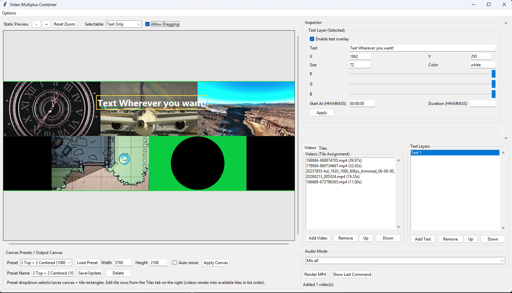

# PRISM - Panoramic Recording & Integrated Stream Multiplexer

A desktop GUI application with two modes, both rendered through FFmpeg:

- **Combine** - tile multiple video feeds into one frame (2x2, five-camera and custom layouts)
- **Edit** - the same tile canvas with a timeline row for every tile: move and trim clips, lay another video's audio underneath, and play the result in the window

Built for users who need a simple visual workflow without opening a full video editor.




## Features

### Edit mode (timeline)

- **Same page as Combine** - the same preview, canvas presets, inspector, layer lists, audio choice and Render button, with a timeline underneath
- **A timeline row per tile** - a video stays where you put it: drag it left or right, or onto another tile's row; a tile can hold several clips one after another
- **Trim** - drag either end of a clip inward; what is left stays exactly where it was (a gap opens instead of the clips closing up). **Close Gaps** pulls them together when you want that
- **Play** - plays the timeline in the preview with sound (`Space`), every tile and the text included
- **Audio from another video** - **Add Audio** puts any video's or audio file's sound on the audio row; or drag a clip down there to keep only its sound
- **Split and remove** - cut a clip at the playhead (`S`) and delete the part you don't want (`Del`)
- **Undo / redo** - every edit, `Ctrl+Z` / `Ctrl+Y`
- **Resizable** - the window opens no larger than the screen; every panel resizes with it, the preview keeping the largest share. Drag the bars between the preview, the side panel, the lists and the timeline to change the split (both tabs)

### Combine mode (tiles)

- **Multi-video layouts** - Combine videos into 2x2 4K, 2x2 1080p, 5-camera, and custom tiled layouts
- **Video trimming** - Trim individual clips with precise start/end timecodes
- **Canvas preview** - Visual thumbnail preview of your layout before rendering
- **Per-tile controls** - Adjust position, size, order, timing, and trim per tile
- **Audio mixing** - Mix all audio tracks, use a single tile's audio, or render silent
- **Text overlays** - Add timed text overlays with configurable positioning
- **H.264 export** - Render to MP4 via FFmpeg with full codec control
- **Portable build** - Package as a standalone Windows executable via PyInstaller

## Requirements

- Python 3.10+
- FFmpeg and FFprobe (must be on your system PATH)
- Pillow

### Installing FFmpeg

Download from [https://ffmpeg.org/download.html](https://ffmpeg.org/download.html) and add the `bin` folder to your system PATH.

Verify installation:
```
ffmpeg -version
ffprobe -version
```

## Run From Source

```powershell
git clone https://github.com/Ram-Rod6198/PRISM.git
cd PRISM
python -m venv .venv
.\.venv\Scripts\python.exe -m pip install -r video_combiner\requirements.txt
.\.venv\Scripts\python.exe Main.py
```

`Main.py --edit` opens straight into Edit mode.

Run the tests (no extra packages needed; the FFmpeg tests skip themselves if FFmpeg is not on PATH):

```powershell
.\.venv\Scripts\python.exe -m unittest discover -s tests -t .
```

## Usage: Edit mode

Open the **Edit (timeline)** tab. It is the Combine page with a timeline along the bottom: one row per tile, and an **Audio** row.

1. **Add Video** - pick one or more videos. Each goes to the first empty tile, as in Combine; once every tile has one, they queue up after the last clip (select a tile first to choose which). A new timeline starts with a single tile, and the first video sets the canvas to its own size. Pick a canvas preset for a tiled layout.
2. **Arrange** - drag a clip left or right to move it, or onto another row to move it to that tile. Drag a clip's left or right end inward to trim it; the rest of the clip does not move. Dropping a clip onto another puts it in front of or behind that one and pushes later clips along. **Close Gaps** makes the clips of each tile play back to back.
3. **Add Audio** - pick the video (or audio file) whose sound you want. It lands on the Audio row at the playhead. The Audio list then switches to *Audio track only*; choose *Mix all* to hear the videos as well, or *Tile N only* for one tile.
4. **Play** - press **Play** or `Space`. Click or drag on the timeline to move the playhead; the preview shows that moment.
5. **Render MP4** - choose where to save. Sound that runs past the last clip is cut off (shown shaded on the timeline).

| Key | Action |
|-----|--------|
| `Space` | Play / pause |
| `S` | Split at the playhead |
| `Del` | Remove the selected clip |
| `Ctrl+Z` / `Ctrl+Y` | Undo / redo |
| `Left` / `Right` | Step one frame (`Shift`: one second) |
| `Home` / `End` | Jump to the start / end |
| `Ctrl` + mouse wheel | Zoom the timeline |

The Inspector takes exact times (`HH:MM:SS`, `MM:SS` or seconds) for a clip's trim and start, exactly as in Combine.

Playback sound uses Windows' built-in player (or `afplay` / `paplay` / `aplay` / `ffplay` elsewhere). A tile shows its clip scaled to fill it, as in Combine.

## Usage: Combine mode

### Adding Videos
- Click **Add Video** and select one or more video files
- Videos appear in the list panel on the right with filename and duration
- Thumbnails are automatically generated and displayed on the preview canvas

### Arranging Tiles
- Use **Up/Down** buttons or drag-and-drop to reorder videos in the list
- The first videos in the list map to tiles in the layout (e.g., first 4 for a 2x2 grid)
- Click a tile or list item to open the inspector panel showing coordinates, duration, and controls

### Tile Inspector
- Adjust individual tile position, size, and order
- Set per-tile start/end trim times
- View tile coordinates and mapped video info

### Audio Options
- **Mix all** - Combine audio from all tiles
- **<Tile> only** - Use only that tile's audio track
- **No audio** - Render without audio

### Text Overlays
- Add timed text overlays positioned anywhere on the canvas
- Configure text content, position, and display timing

### Rendering
- Select an output path and click **Render**
- Output is H.264 MP4 via FFmpeg (libx264, yuv420p, CRF 18)
- Output FPS matches the first video in the list
- Shorter videos display black after they end; output duration matches the longest video
- Progress shows in the status bar, with Cancel; **FFmpeg Log** shows the exact command and FFmpeg's output

### Layout Presets
| Preset | Output Resolution | Tile Size |
|--------|-------------------|-----------|
| 2x2 4K | 3840x2160 | 1920x1080 per tile |
| 2x2 1080p | 1920x1080 | 960x540 per tile |
| 5-video | Custom | Mixed sizes |

## Build Portable Windows EXE

Place FFmpeg binaries under `video_combiner/assets/ffmpeg/bin/` then run:

```powershell
.\build_portable.ps1
```

Output is written to `dist/`. Attach the exe or zip to a GitHub Release rather than committing binaries.

## Project Structure

```
PRISM/
  Main.py                        # Entry point
  tests/                         # unittest suite (python -m unittest discover -s tests -t .)
  video_combiner/
    app.py                       # The window: one tab per mode over a shared export bar
    workspace.py                 # TileWorkspace: the page layout both tabs are built on
    project.py                   # TileProject: canvas, tiles, videos, text (what both documents share)
    preview.py                   # Clickable canvas preview (thumbnails, exact frames, playback picture)
    inspector.py                 # Editors for the selected video / tile / text
    canvas_bar.py                # Preset and canvas-size controls
    presets.py                   # Built-in and saved canvas presets
    filters.py                   # FFmpeg filter-graph pieces both composers use
    ffmpeg.py                    # All FFmpeg/FFprobe access: load media, still frames, encodes, frame streams
    export.py                    # ExportBar: runs encodes in the background, progress, cancel, log
    speaker.py                   # Plays a sound file through the speakers
    media_picker.py              # "Choose files" dialog that returns only usable media
    timecode.py                  # Parsing and formatting of times
    widgets.py                   # Shared Tk widgets (resizable panes, layer list, scroll area, UI-thread calls)
    combiner/                    # Combine mode: the n-th video plays in the n-th tile
      project.py                 # CombinerProject
      composer.py                # project -> FFmpeg arguments
      workspace.py               # The Combine tab
    editor/                      # Edit mode: every tile has a track of clips
      timeline.py                # Timeline: place, trim, split, close gaps, undo
      composer.py                # timeline -> FFmpeg arguments, for export and for playback
      player.py                  # Real-time playback: frames from FFmpeg, paced against the sound
      timeline_view.py           # Mouse-editable timeline
      workspace.py               # The Edit tab
```

## Architecture

Both tabs are the same page (`TileWorkspace`) over the same kind of document (`TileProject`): a canvas of tiles, videos shown in them, text on top. The preview, inspector, canvas bar and layer lists are written once against that and know nothing of the modes. A mode adds only what is its own:

- **Document** (`CombinerProject`, `Timeline`) - which tile a video plays in and when, plus the rules that keep that valid. No Tk, no FFmpeg.
- **Composer** (`compose(document)`) - turns a document into FFmpeg arguments. A pure function, so it is tested by comparing strings.
- **Workspace** - a small subclass of the shared page. Edit adds the timeline view and the player.

Everything shares `ffmpeg.py` (the only module that knows where the binaries are, how to launch them and how to read their output) and `ExportBar` (the only place encodes are run from the UI).

## Tech Stack

Python | Tkinter | FFmpeg | FFprobe | Pillow | PyInstaller

## License

MIT
