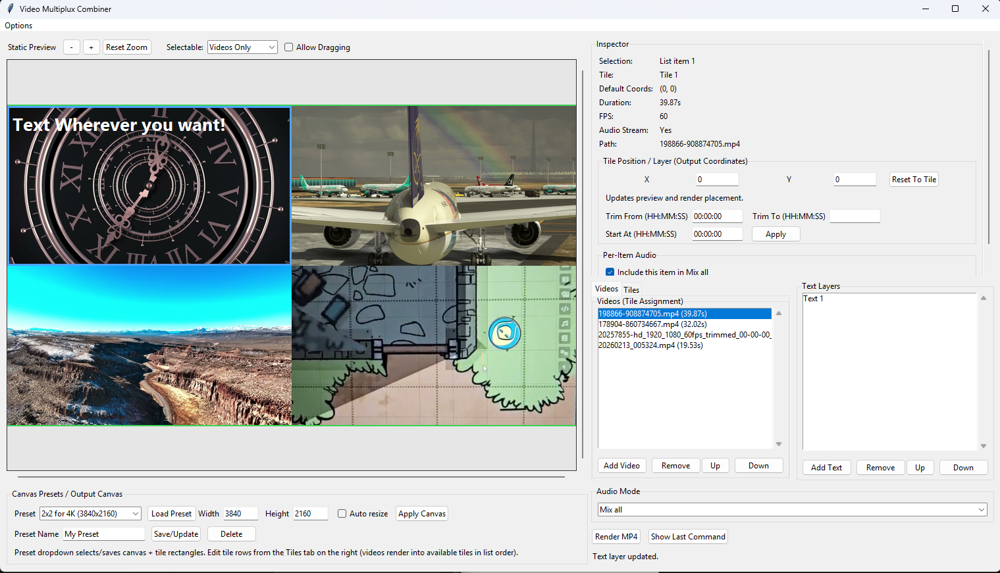

# PRISM - Panoramic Recording & Integrated Stream Multiplexer

A desktop GUI application for combining multiple video feeds into tiled layouts and trimming video clips, all rendered through FFmpeg. Built for users who need a simple visual workflow without opening a full video editor.




## Features

- **Multi-video layouts** - Combine videos into 2x2 4K, 2x2 1080p, 5-camera, and custom tiled layouts
- **Video trimming** - Trim individual clips with precise start/end timecodes
- **Canvas preview** - Visual thumbnail preview of your layout before rendering
- **Per-tile controls** - Adjust position, size, order, timing, and trim per tile
- **Audio mixing** - Mix all audio tracks, use a single tile's audio, or render silent
- **Text overlays** - Add timed text overlays with configurable positioning
- **H.264 export** - Render to MP4 via FFmpeg with full codec control
- **Portable build** - Package as a standalone Windows executable via PyInstaller

## Requirements

- Python 3.10+
- FFmpeg and FFprobe (must be on your system PATH)
- Pillow

### Installing FFmpeg

Download from [https://ffmpeg.org/download.html](https://ffmpeg.org/download.html) and add the `bin` folder to your system PATH.

Verify installation:
```
ffmpeg -version
ffprobe -version
```

## Run From Source

```powershell
git clone https://github.com/Ram-Rod6198/PRISM.git
cd PRISM
python -m venv .venv
.\.venv\Scripts\python.exe -m pip install -r video_combiner\requirements.txt
.\.venv\Scripts\python.exe Main.py
```

## Usage

### Adding Videos
- Click **Add Video** and select one or more video files
- Videos appear in the list panel on the right with filename and duration
- Thumbnails are automatically generated and displayed on the preview canvas

### Arranging Tiles
- Use **Up/Down** buttons or drag-and-drop to reorder videos in the list
- The first videos in the list map to tiles in the layout (e.g., first 4 for a 2x2 grid)
- Click a tile or list item to open the inspector panel showing coordinates, duration, and controls

### Tile Inspector
- Adjust individual tile position, size, and order
- Set per-tile start/end trim times
- View tile coordinates and mapped video info

### Audio Options
- **Mix all** - Combine audio from all tiles
- **Tile N only** - Use only a specific tile's audio track
- **None** - Render without audio

### Text Overlays
- Add timed text overlays positioned anywhere on the canvas
- Configure text content, position, and display timing

### Rendering
- Select an output path and click **Render**
- Output is H.264 MP4 via FFmpeg (libx264, yuv420p, CRF 18)
- Output FPS matches the first video in the list
- Shorter videos display black after they end; output duration matches the longest video
- Render progress streams to the status bar

### Layout Presets
| Preset | Output Resolution | Tile Size |
|--------|-------------------|-----------|
| 2x2 4K | 3840x2160 | 1920x1080 per tile |
| 2x2 1080p | 1920x1080 | 960x540 per tile |
| 5-video | Custom | Mixed sizes |

## Build Portable Windows EXE

Place FFmpeg binaries under `video_combiner/assets/ffmpeg/bin/` then run:

```powershell
.\build_portable.ps1
```

Output is written to `dist/`. Attach the exe or zip to a GitHub Release rather than committing binaries.

## Project Structure

```
PRISM/
  Main.py                          # Entry point
  video_combiner/
    app.py                         # App bootstrap
    src/
      model.py                     # Data model (VideoItem, VideoListModel, TextOverlaySettings)
      composer.py                  # FFmpeg filter graph and command composition
      render.py                    # FFmpeg rendering execution
      probe.py                     # FFprobe metadata extraction
      thumbs.py                    # Thumbnail generation service
      ui_main.py                   # Main application window
      ui_inspector.py              # Tile/text inspector panel
      ui_list.py                   # Video, tile, and text list panels
      ui_preview.py                # Canvas-based layout preview
      utils.py                     # Timecode parsing, formatting utilities
```

## Architecture

PRISM separates concerns into distinct layers:

- **Model** - `VideoItem`, `VideoListModel`, and `TextOverlaySettings` manage all project state
- **Services** - `ProbeService`, `ThumbnailService`, `FFmpegComposer`, and `FFmpegRenderer` handle all FFmpeg interaction
- **UI** - Tkinter/ttk components (`PreviewCanvas`, `InspectorPanel`, list panels) bind to the model

## Tech Stack

Python | Tkinter | FFmpeg | FFprobe | Pillow | PyInstaller

## License

MIT
